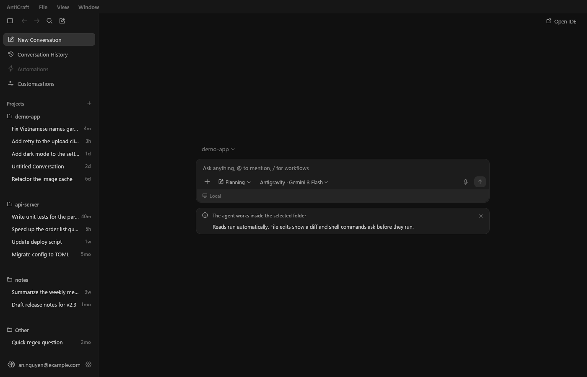
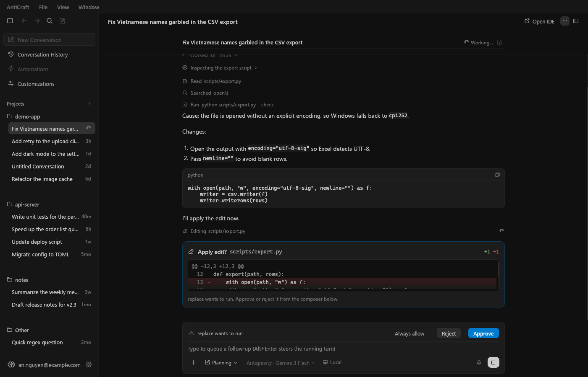
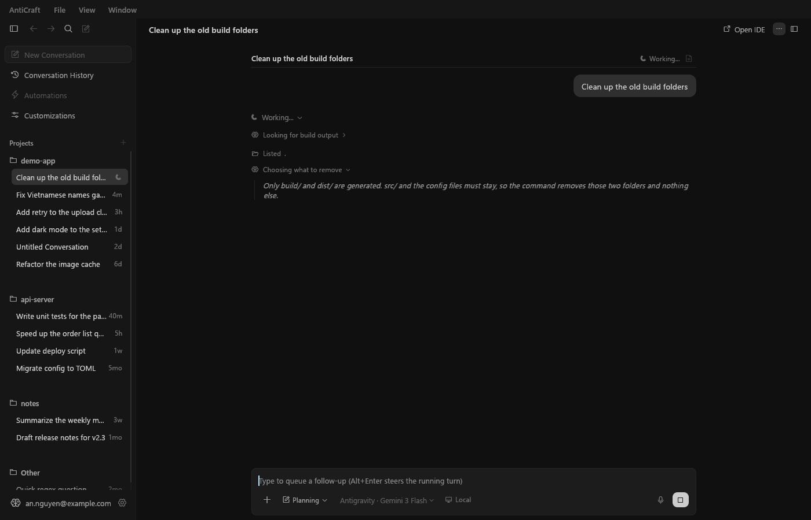
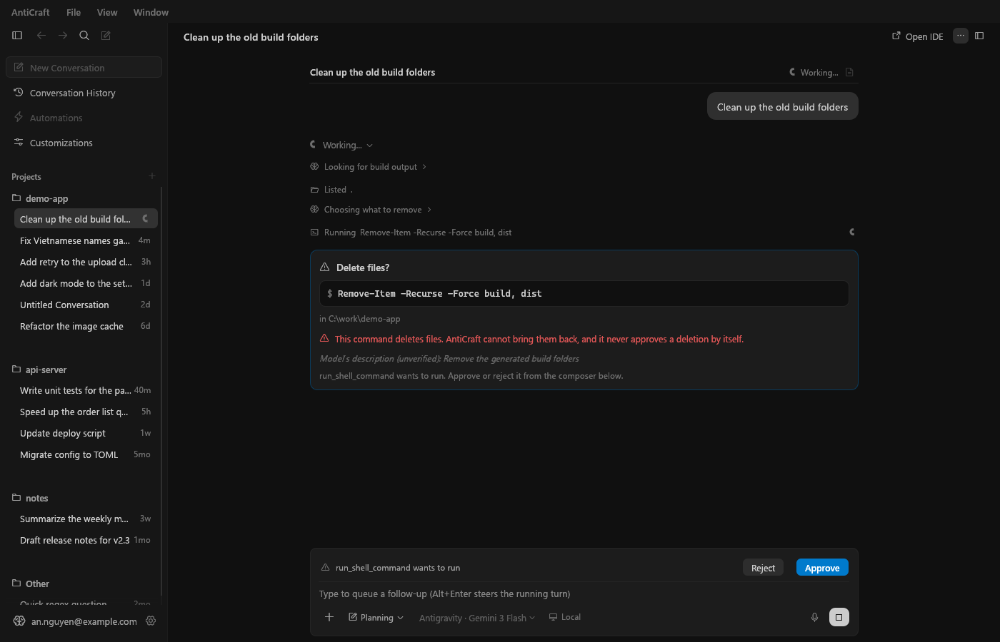
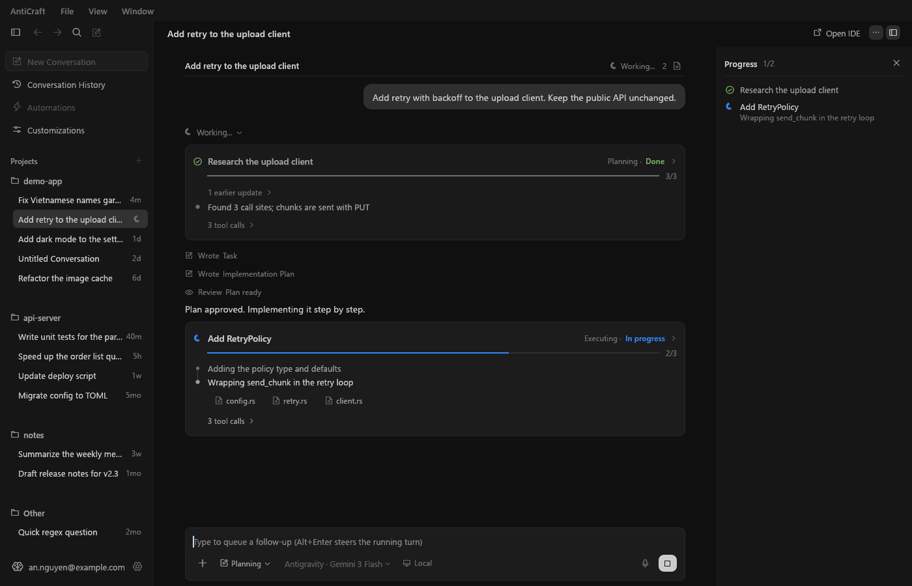
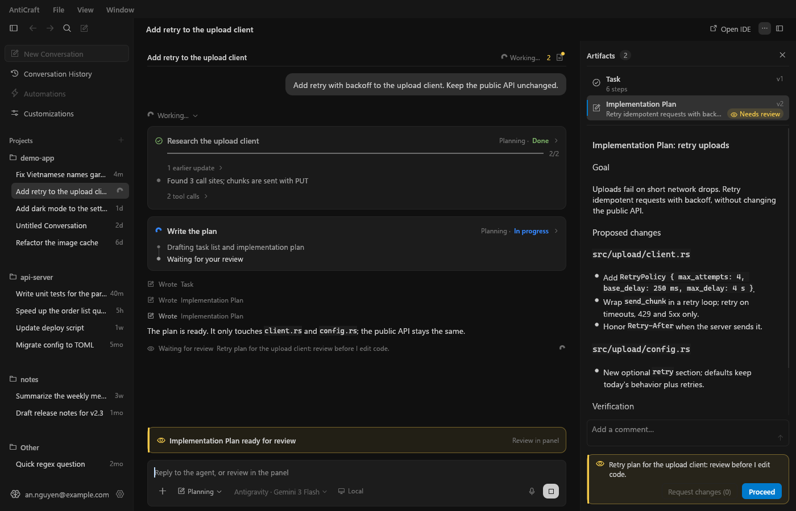
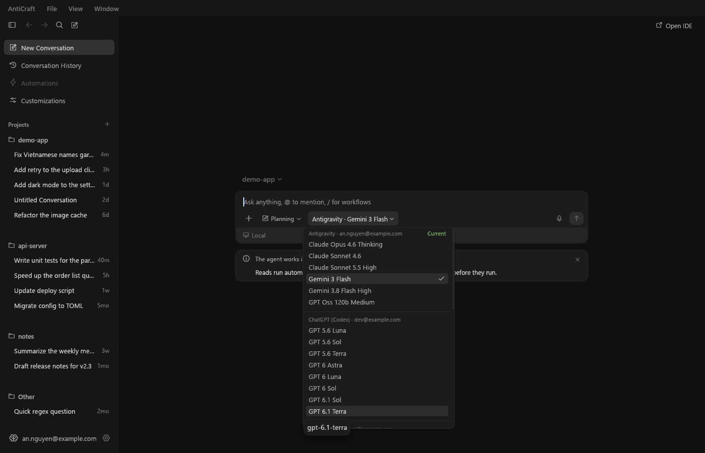
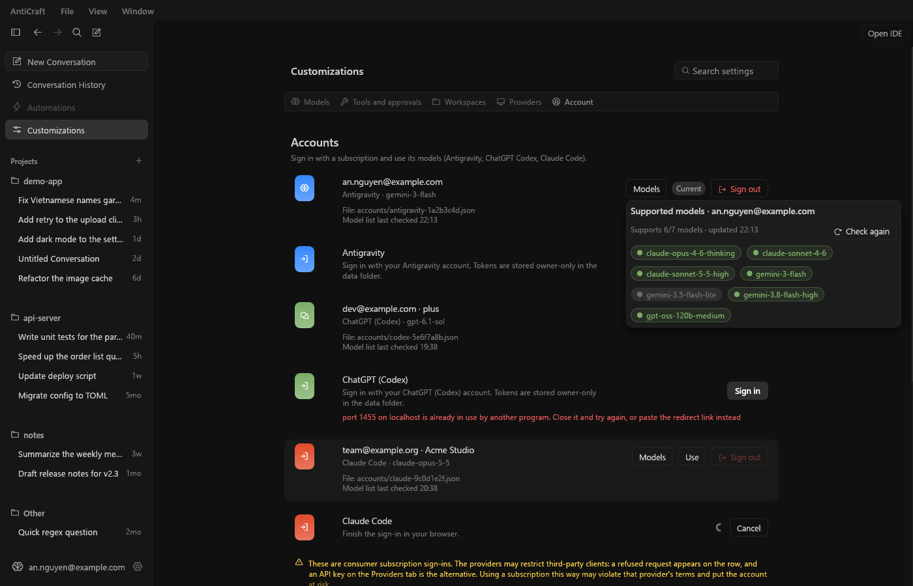
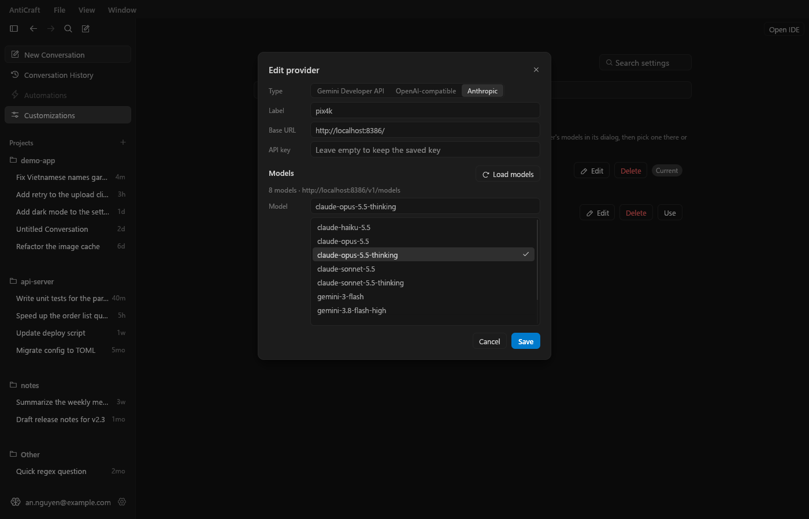
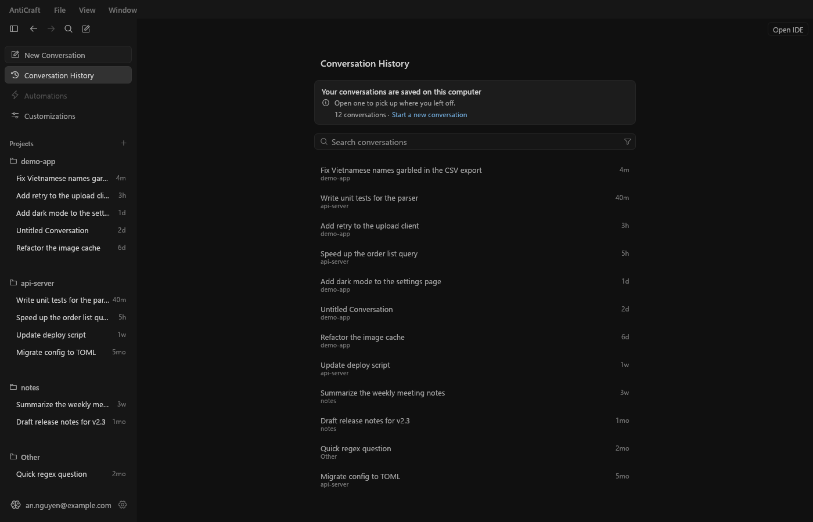

# AntiCraft

<!-- updates:start (generated by push_github from push_github/version.json; do not edit by hand) -->
## Updates

### v0.9.6 (2026-11-13) · latest
[Download AntiCraft.zip](https://github.com/mindeskvn/AntiCraft/releases/download/v0.9.6/AntiCraft.zip) · [Release page](https://github.com/mindeskvn/AntiCraft/releases/tag/v0.9.6)

- First release on GitHub (Windows 10/11, 64-bit).
- Every file deletion waits for your approval and shows a red warning: emptying a file, and shell commands too (rm, del, Remove-Item, git rm/clean...), even with --dangerously-skip-permissions.
- Rewind the conversation history to before any message; conversations are also backed up silently on every save.
- Turbo mode understands quoting in PowerShell commands, so lines such as python -c "..." no longer ask again.
- UI: the thought being reasoned stays open and folds away once it is done; tool-call and Thinking rows are smaller and dimmer than the answer text.

<!-- updates:end -->

## AntiCraft native at a glance

These pictures come from the app's built-in demo screens, which use sample data (`anticraft-native.exe --demo <screen> --screenshot <file>.png`).

### Start in your project



Pick the project folder above the request box and describe the task. Type `@` to mention a file or folder and `/` to start a workflow; the chips under the box set the mode (here Planning) and the model. The sidebar groups your conversations by project. The agent works only inside the selected folder: reads run on their own, file edits show a diff, and shell commands ask before they run.

### Work through a real task



The agent reads files, searches the code and runs commands. Each step is a quiet one-line row, so the answer stays easy to read. A change to a file arrives as a diff right in the conversation: approve or reject it from the composer (Enter or Esc), or allow that tool for the rest of the session.

### Follow the reasoning



The thought the model is working on stays open while it runs, then folds into one row as soon as a tool call or the answer follows. Click a row to read it again.

### Deletions always wait for you



A command that deletes files (`rm`, `del`, `Remove-Item`, `git rm`, `git clean`...) or a write that would empty a file is never approved automatically: not in Turbo mode, not by an allow rule, not even with `--dangerously-skip-permissions`. The card says so in red, and "Always allow" is not offered.

### Plans and progress for bigger tasks



In Planning mode the agent splits the work into tasks. Each task shows its phase, its status, its latest updates and the files it touched, and the Progress panel follows the whole turn. You can queue a follow-up while it works, or press Alt+Enter to steer the running turn.

### Review the plan before any code changes



Before it edits code, the agent writes a task list and an implementation plan. The Artifacts panel keeps every version (v1, v2) and holds the plan for your review: comment on it, request changes, or press Proceed.

### Every model in one menu



The model menu lists the models of every signed-in account (Antigravity, ChatGPT Codex, Claude Code) and of your API-key providers. The choice applies from the next message.

### Sign in with your subscriptions



Customizations > Account signs in to Antigravity, ChatGPT (Codex) and Claude Code. Each account shows which models it actually serves, and is put in use or signed out on its own row. When something goes wrong, the row says what happened and offers a way out, such as pasting the redirect link when the callback port is busy. These are consumer subscriptions: a provider may restrict third-party clients, and using them this way may break its terms.

### Or bring your own API keys



Add Gemini Developer API, OpenAI-compatible or Anthropic endpoints with an API key, load the models the endpoint serves, and pick one.

### Pick up where you left off



Conversations are saved on your computer. Conversation History lists them with their project and age, and searches them; open one to continue.

## What is in this repository

This repository holds two Windows programs:

| Folder | Program | What it is |
|---|---|---|
| [`native/`](native/) | `anticraft-native.exe` | **AntiCraft native**, the main app: a Rust (egui) coding assistant that chats with Gemini and other models, and can read, search and edit files and run commands in a workspace you choose. See [native/README.md](native/README.md). Ready-to-run builds are on the [Releases](https://github.com/mindeskvn/AntiCraft/releases) page. |
| `src/` (crate at the repository root) | `anticraft.exe` | The AntiCraft desktop shell. It needs an installed Antigravity. The rest of this README is about it. |

## AntiCraft desktop shell

AntiCraft is a Rust desktop shell written clean-room from `SPEC.md`. It reproduces the behavior of the Antigravity Desktop Shell v2.26.0, using tao, wry (WebView2), muda and tray-icon. It runs the installed Antigravity `language_server.exe` and loads the UI that the language server serves at `https://127.0.0.1:<port>/`.

## Build and run

Requires Rust 1.95 (`x86_64-pc-windows-msvc`), the WebView2 runtime, and an installed Antigravity (for `language_server.exe`).

From the repository root:

```
cargo build --release
cargo test
cargo clippy --all-targets -- -D warnings
target\release\anticraft.exe
```

All dependencies are pinned to exact versions in `Cargo.toml`.

## CLI

| Flag | Effect |
|---|---|
| `--user-data-dir=<dir>` | userData directory. Default is `%APPDATA%\AntiCraft`; env `ANTICRAFT_USER_DATA` overrides it. |
| `--ls-path=<exe>` | LS binary. Fallbacks, in order: env `CODEIUM_LANGUAGE_SERVER_BIN`, then `%LOCALAPPDATA%\Programs\Antigravity\resources\bin\language_server.exe`. |
| `--headless` | No UI. stdin lines are forwarded to the LS (OAuth code paste). Ctrl+C quits. Env `ELECTRON_OZONE_PLATFORM_HINT=headless` does the same. |
| `--dev-url=<url>` | Skips the LS and loads this URL. Env `DEV_URL` does the same. |
| `--remote-debugging-port=<n>` | WebView2 CDP port. Defaults to `0` (random) when absent (§14). |
| `--wsl-distro=<name>` | Accepted for compatibility. A warning is logged and the shell runs locally. |
| `--no-register-protocol` | Skips the `antigravity://` registration. |
| `--unregister-protocol` | Deletes `HKCU\Software\Classes\antigravity` only if its open command points at this exe, then exits. |

Unknown switches (for example Chromium-style `--disable-gpu`) are logged and ignored instead of aborting startup. Positional arguments, such as `antigravity://...` deep links, are kept.

## Protocol registration

On every startup, AntiCraft writes `HKCU\Software\Classes\antigravity` with an open command of `"<anticraft.exe>" "%1"`. This replaces the original app's registration, so `antigravity://` links, including OAuth callbacks, go to AntiCraft. To give the links back, run `anticraft --unregister-protocol`, or simply launch the original Antigravity, which re-registers itself.

## What is implemented

- Startup orchestration (§2):
  - single instance per userData; the key uses the canonicalized, case-folded path
  - a second-instance named pipe that is served before the LS starts, so deep links forwarded during startup are queued, not lost
  - storage and settings, the `--stamp` query, and the host bridge
  - LS launch with crash supervision (3 restarts per 60 s), the line rules, and the stderr crash trace
  - the kill-on-close Job Object
- Windows (§4): one per LS URL, with a loading overlay, title truncation, zoom persistence (only for the initial and Ctrl+Shift+N windows) and theme colors.
- The preload bridge (`bridge.js`) with the §5 IPC channels, and the `plugin://` proxy.
- Menu, tray and keybindings (§8), deep links (§9).
- `app_storage.json` (§6.1) and settings side effects.
- Host bridge Connect service (§7): `GetUpdateStatus` and `ApplyUpdate`.
- Auto-updater (§13), generic provider.
- Quit teardown (§2.1). The Confirm Quit dialog has Quit and Cancel buttons. Teardown stops the LS (5 s grace), then closes the host bridge. It runs in UI and headless mode alike, including for quit-and-install.

## Deviations and unimplemented spec items

- **WSL mode (§10).** Not implemented.
  - The splash, provisioning, path mapping and relaunch are all missing.
  - `wsl:get-state` returns the real distro list with `activeDistro: ""`.
  - `wsl:connect` only logs.
  - The WSL menu and tray items are omitted.
- **IDE install wizard (§12).** Not implemented.
- **BeyondCorp PAC (§11).** Not implemented. WebView2 has no per-session proxy API and no `<webview>` partitions.
- **`<webview>` guests.** WebView2 has no `<webview>` tag. As a result:
  - `webview:execute-js-isolated-world` always rejects.
  - The web UI's built-in browser pane may not work.
- **`getPathForFile`.** WebView2 does not expose DOM File paths, so this is best-effort and often returns `''`.
- **Title bar overlay.** The window uses the native frame, so `window:set-title-bar-overlay` is a no-op.
- **Confirm Quit detail.** The Win32 message box has no separate detail line, so the detail text follows the message after a blank line.
- **About panel.** None. The `--stamp` CL is only logged, and the call is bounded to 30 s.
- **macOS-only items.** Dock menu, `open-url` and the app-menu "Check for Updates" do not apply on Windows. "Check for Updates" lives under Help instead.
- **`window.open` / target=_blank.** These use the same scheme allowlist as `shell:open-external` (http, https, antigravity-ide) instead of opening any URL.
- **IPC origin check.** IPC is accepted only from `https://127.0.0.1:<lsPort>` or the dev URL origin.
- **TLS (§3.6).**
  - WebView2 gets `--allow-insecure-localhost`.
  - A `ServerCertificateErrorDetected` handler allows errors only for `127.0.0.1` and `localhost`.
  - There is no global certificate ignore.
- **Keybindings (§8.3).** Ctrl+Shift+N, Ctrl+Q and Ctrl+wheel zoom are intercepted in the injected `bridge.js`, because the webview owns keyboard focus. Wheel zoom uses an internal channel and is persisted only for windows that own the storage manager. The explicit `window:zoom-*` IPC always persists, as in §5.2.
- **`plugin://` (§4.4).**
  - wry serves custom protocols on WebView2 as `https://plugin.<authority>/...`. Sidecar pages therefore have that origin, not `plugin://<authority>`.
  - An injected shim rewrites literal `plugin://` URLs (fetch, XHR, `window.open`, `src`/`href` setters, `setAttribute`). It cannot cover navigations typed or built outside those APIs.
  - Hardening, not in the spec:
    - `extensions:send-authorities` keeps only `http(s)://<loopback>:<port>` origins; others are logged and dropped. A non-object argument rejects instead of clearing the map.
    - A target that resolves outside the stored origin gets a 404.
    - Redirects are not followed.
    - `Cookie`, `Authorization`, `Proxy-*` and hop-by-hop request headers are not forwarded. `Set-Cookie` and hop-by-hop response headers are not copied back.
- **`shell:reveal-in-file-picker`.** Accepts only existing drive-letter paths (no UNC or device paths), and reveals through `SHOpenFolderAndSelectItems` instead of an `explorer.exe` command line.
- **DevTools port file.** `AGY_BROWSER_ACTIVE_PORT_FILE` points at `<userData>\WebView2\EBWebView\DevToolsActivePort`. That is where the WebView2 browser process writes the file, not `<userData>\DevToolsActivePort`. Not verified at runtime.
- **CDP endpoint (accepted risk).** The spec requires `--remote-debugging-port`, so an unauthenticated CDP endpoint listens on loopback. Any local process can attach to it and drive the trusted LS page.
- **LS environment (§3.2).** The LS gets the shell's own environment plus the §3.2 additions. There is no login-shell (`shell-env`) merge, which is effectively a no-op on Windows anyway.
- **LS process.** It is spawned suspended, assigned to the kill-on-close job, then resumed, and it also has `kill_on_drop`. Headless stdin goes through a bounded writer task.
- **Crash log text (§3.5).** Windows has no signals. An exit with no code logs "killed by signal unknown", and the startup-failure error always reports `signal=null`.
- **`JETSKI_LS_PORT`.** Coerced with JS `Number()` rules: `0x`/`0o`/`0b`, case-sensitive `Infinity`, and decimal or exponent forms. The trimmed literal is passed to the LS, not the coerced number.
- **Node wrapper.** `agy-node.cmd` is written only when the installed `Antigravity.exe` exists, and it always points at that exe, never at AntiCraft.
- **Updater.** It implements the generic-provider flow itself:
  - Fetches `latest-x64-win.yml` with the `x-app-version` header. Connect timeout is 30 s, read timeout 60 s.
  - Only one check runs at a time.
  - `downloading` is broadcast on the first chunk, with no version. `updater:apply` broadcasts exactly `{type:"ready"}`.
  - Streams the installer into `%LOCALAPPDATA%\anticraft-updater` as `<name>.partial`. The SHA-512 is computed incrementally, the size is capped at 1 GiB, and the file is renamed on success. The name comes from the URL's last path segment, with Windows-reserved characters replaced.
  - quit-and-install requests a normal quit. After the LS and bridge are down, the file is re-hashed and its Authenticode signature checked (WinVerifyTrust). Only then is it launched with `--updated`, plus `/S` in headless mode. The publisher is not pinned.
  - The current version defaults to `2.26.0`, the installed Antigravity version. An Antigravity update therefore installs Antigravity, not AntiCraft.
- **Headless second instance.** Argv forwarded to a headless primary is accepted. Because there is no window to dispatch to, a deep link is printed and logged.
- **Icons.** No image decoder is bundled. The window and tray icons are drawn procedurally.
- **Notifications.** They use notify-rust (WinRT toast). Click handling is not wired, so `notification:clicked` is never emitted.
- **Host bridge.** Serves Connect unary only, with JSON and binary proto. gRPC and gRPC-Web framing are not supported.

## Clean-room note

This crate was written only from the behavioral specification in `SPEC.md`. The original application's source was not consulted. Interop identifiers are used verbatim where compatibility requires them: CLI flags, IPC channels, environment variables, URLs, proto fields and UI strings. Everything else is an original Rust design. The flagged areas (WSL listing parse, storage update, updater status/apply mapping) were rewritten independently from the spec text.
